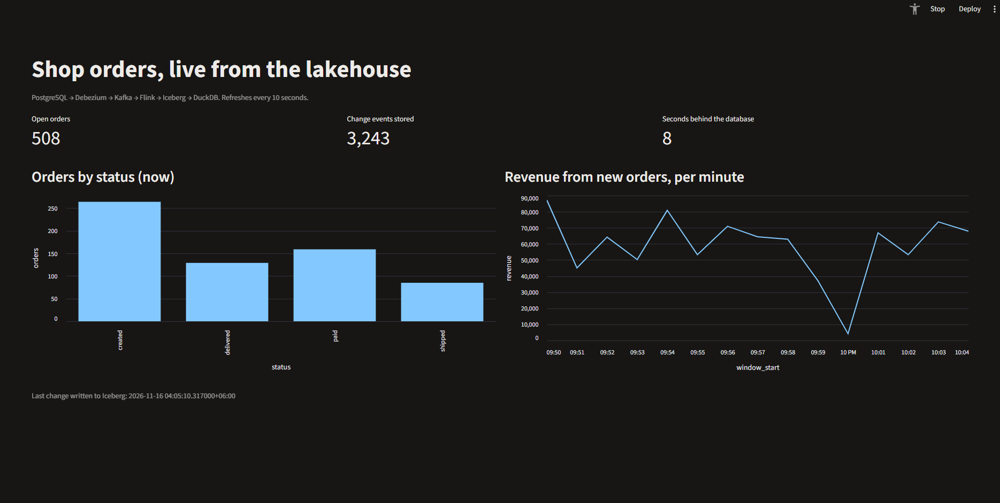
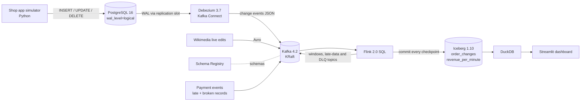

# Real-time CDC and Streaming Lakehouse

Every insert, update and delete in an operational PostgreSQL database is captured with **Debezium**, streamed through **Kafka**, processed with **Flink SQL** (windows, watermarks, late data, a dead-letter queue) and written into **Apache Iceberg** tables every ~10 seconds, where **DuckDB** and a live **Streamlit** dashboard query them. It runs entirely on a laptop with Docker, at no cost.



## Architecture



## What it shows

| Area | What I built |
|---|---|
| **Kafka fundamentals** | KRaft single-node cluster; keys, partitions, ordering, consumer groups, rebalancing, offsets and lag |
| **Schemas** | Live Wikipedia edits produced as **Avro** with **Schema Registry**; bad records rejected before reaching Kafka; BACKWARD compatibility checks for schema evolution |
| **Change data capture** | **Debezium** reads PostgreSQL's WAL through a replication slot: snapshot then stream, full `before`/`after` rows (REPLICA IDENTITY FULL), tombstones, recovery with no data loss after Connect downtime |
| **Stream processing** | **Flink SQL**: changelog aggregation with retractions, tumbling and hopping event-time windows, watermarks, idle-partition handling, checkpoints |
| **Data quality** | Validation stage that routes broken messages to a **dead-letter queue** with a reason; late events routed to their own topic instead of being dropped; DLQ repair-and-replay tool |
| **Streaming lakehouse** | Flink writes the full change history and per-minute revenue to **Iceberg**; current state rebuilt with `ROW_NUMBER`; exactly-once commits at checkpoints |
| **Serving** | DuckDB queries Iceberg directly from files; Streamlit dashboard refreshing every 10 seconds |

## Tech stack

Kafka 4.2 (KRaft) · Confluent Schema Registry 8.3 · Avro · Debezium 3.7 (Kafka Connect) · PostgreSQL 16 · Flink 2.0 SQL · Apache Iceberg 1.10 · DuckDB · Streamlit · Python (confluent-kafka, psycopg) · Docker Compose · Kafka UI

## Repository layout

```
app/          shop_simulator.py (writes to PostgreSQL), lake_dashboard.py (Streamlit)
producers/    Kafka producers: order events, Wikimedia (Avro), payments (late + broken)
consumers/    CDC watcher, DLQ report and replay, DuckDB lakehouse check
connectors/   Debezium connector configuration
schemas/      Avro schema for Wikimedia edits
flink/sql/    Flink SQL: tables, windowed queries, DLQ pipeline, Iceberg job
docker/       Compose files (Kafka, CDC, Flink) and the Flink image
scripts/      start-up and helper scripts
```

## How to run

Requirements: Docker Desktop (with WSL 2 on Windows), Python 3.12, about 4 GB of free memory.

```bash
python3 -m venv .venv && source .venv/bin/activate
pip install "confluent-kafka[avro]" requests "psycopg[binary]" duckdb streamlit pytz

./scripts/demo_up.sh                       # Kafka, PostgreSQL, Debezium, Flink, connector, Iceberg job
python app/shop_simulator.py --n 0         # terminal 2: keep changing the database
streamlit run app/lake_dashboard.py        # terminal 3: http://localhost:8501
```

Useful pages: Flink UI http://localhost:8091 · Kafka Connect API http://localhost:8083 · Kafka UI http://localhost:8090 (start with `./scripts/cdc_up.sh`).

## Design decisions

- **CDC from the WAL instead of polling.** Polling with `updated_at` misses deletes and intermediate updates and adds load to the database. Debezium reads the log the database already writes, with no application changes.
- **Message key = primary key.** All changes to one row land on one partition, so they stay in order.
- **REPLICA IDENTITY FULL.** Updates and deletes carry the full previous row, which Flink needs to retract old results correctly.
- **Event time with watermarks, not processing time.** Results stay correct when the pipeline is slow or replays data. A 5 to 10 second watermark delay balances latency against completeness, and the late-data topic measures what is still missed.
- **Validate, then process.** Messages are read as raw text and validated in SQL, so one malformed message can never crash the job; bad records go to a DLQ with a reason and can be replayed.
- **Store the change history in Iceberg, rebuild state with SQL.** Append-only history is simple, auditable and readable by any engine; the current state is a `ROW_NUMBER` query away.
- **Commit every 10-second checkpoint.** Data is about 10 seconds fresh, and a failure never exposes half-written data.

## What I would change for production

- Replicated Kafka (3 brokers, replication factor 3) and Flink with high availability and RocksDB state.
- Avro with Schema Registry for the CDC topics as well, not JSON.
- Iceberg on object storage with a REST catalog (for example Polaris), plus scheduled compaction and snapshot expiry to handle small files.
- Upsert Iceberg tables (equality deletes) where consumers need current state directly.
- Monitoring of consumer lag, replication-slot WAL size, checkpoint duration and DLQ volume, with alerts.
- Secrets in a secrets manager instead of configuration files.

## Lessons learned

- **Kafka listeners:** containers must use `kafka:29092`, the laptop `localhost:9092`. A wrong advertised address connects, then hangs.
- **Memory is a design constraint.** Kafka, Connect, Flink and the database had to fit in about 5.8 GB, so each module started only the services it needed and every JVM had an explicit heap limit.
- **An idle partition stops time.** Without `table.exec.source.idle-timeout`, one quiet partition holds back the watermark and windows never close.
- **Small details break SQL pipelines:** `METHOD` is a reserved word in Flink SQL, and the SQL client only ends a statement when a line *ends* with `;`.
- **File systems matter.** Iceberg's local writer changes file permissions, which a Windows-mounted drive refuses, so the warehouse lives on the Linux disk; files created through `docker exec` as root blocked the Flink user until permissions were fixed.
